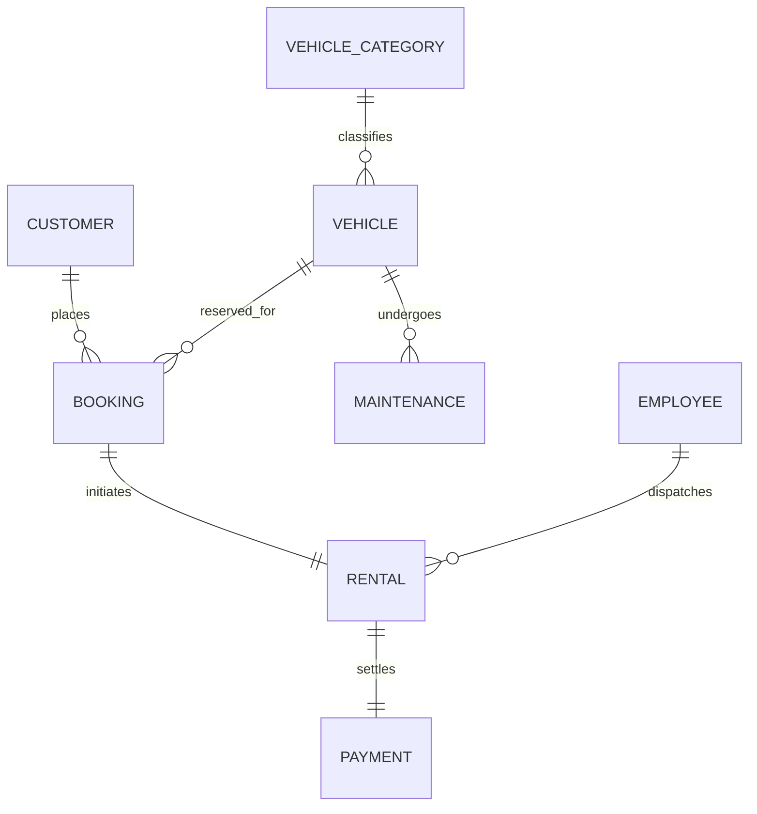

# DriveEase – Premium Vehicle Rental Management System
> **An Enterprise-Grade, Responsive Web Application built on an 8-Table Relational DBMS Architecture.**

---

## 🌟 Executive Summary

**DriveEase** is a modern, responsive vehicle rental platform designed to simulate a real-world commercial enterprise while maintaining strict technical adherence to an academic Relational Database Management System (DBMS) project. 

Unlike basic CRUD college projects, DriveEase combines:
- **High-End Automotive SaaS Aesthetic**: Dark slate themes, glassmorphism blur effects, smooth micro-interactions, responsive sidebars, toast notifications, and interactive telemetry dashboards.
- **Relational Integrity Engine**: Built on 8 interconnected database tables with primary keys, foreign keys, cascade constraints, and automated business rule enforcement.
- **Academic Viva & ERD Suite**: Dedicated interactive Entity-Relationship Diagram (ERD) explorer, SQL DDL script viewer, and live SQL query playground executing 3-table joins, category aggregations, and fleet telemetry metrics against the active database.

---

## 🗄️ Relational DBMS Database Structure (8 Tables)



### Table Definitions & Primary/Foreign Keys

| Table | Primary Key | Foreign Keys | Key Attributes & Description |
| :--- | :--- | :--- | :--- |
| **`CUSTOMER`** | `CUSTOMER_ID` | None | `NAME`, `PHONE`, `EMAIL` (Unique), `ADDRESS`, `DRIVER_LICENSE_NO` (Unique), `LICENSE_EXPIRY` |
| **`VEHICLE_CATEGORY`** | `CATEGORY_ID` | None | `CATEGORY_NAME` (Economy, Sedan, SUV, Luxury), `DESCRIPTION`, `BASE_RATE` |
| **`VEHICLE`** | `VEHICLE_ID` | `CATEGORY_ID` → `VEHICLE_CATEGORY` | `VEHICLE_NO` (Unique Plate), `BRAND`, `MODEL`, `BASE_RATE`, `STATUS` (AVAILABLE, BOOKED, RENTED, UNDER MAINTENANCE), `ODOMETER`, `FUEL_TYPE`, `TRANSMISSION` |
| **`BOOKING`** | `BOOKING_ID` | `CUSTOMER_ID` → `CUSTOMER`<br>`VEHICLE_ID` → `VEHICLE` | `BOOKING_DATE`, `START_DATE`, `END_DATE`, `DAYS`, `TOTAL_AMOUNT`, `STATUS` (CONFIRMED, COMPLETED, CANCELLED), `PICKUP_HUB` |
| **`RENTAL`** | `RENTAL_ID` | `BOOKING_ID` → `BOOKING`<br>`VEHICLE_ID` → `VEHICLE`<br>`CUSTOMER_ID` → `CUSTOMER` | `PICKUP_DATE`, `RETURN_DATE`, `ODOMETER_START`, `ODOMETER_END`, `STATUS` (ACTIVE, COMPLETED), `INSPECTION_NOTES` |
| **`PAYMENT`** | `PAYMENT_ID` | `RENTAL_ID` → `RENTAL`<br>`BOOKING_ID` → `BOOKING` | `PAYMENT_DATE`, `AMOUNT`, `PAYMENT_METHOD` (Card, UPI, Net Banking), `STATUS` (PAID), `TRANSACTION_ID` (Unique) |
| **`MAINTENANCE`** | `MAINTENANCE_ID` | `VEHICLE_ID` → `VEHICLE` | `SERVICE_DATE`, `DESCRIPTION`, `COST`, `STATUS` (IN_PROGRESS, COMPLETED), `TECHNICIAN` |
| **`EMPLOYEE`** | `EMPLOYEE_ID` | None | `NAME`, `PHONE`, `EMAIL`, `ROLE` (Admin, Fleet Manager, Rental Staff, Maintenance Staff), `DEPARTMENT` |

---

## ⚡ Core Business Rules Enforced

1. **Relational Reservation**: A Customer makes a Booking for a specific Vehicle. When confirmed, the Vehicle status automatically transitions to `BOOKED`.
2. **Maintenance Lockout**: Any vehicle scheduled for service in the `MAINTENANCE` table automatically receives `UNDER MAINTENANCE` status. **It is immediately locked and cannot be booked or rented by customers**.
3. **Dispatch & Trip Tracking**: When a staff member starts a Rental from a Booking, the Vehicle status automatically becomes `RENTED`.
4. **Automated Fleet Return**: When a rental is completed and checked in (recording ending odometer reading), the Vehicle's status is **automatically restored to `AVAILABLE`** in the fleet pool.
5. **Ledger Connection**: Every payment transaction is strictly linked to its corresponding `RENTAL_ID` and `BOOKING_ID` with itemized GST, insurance, and daily tariffs.
6. **Data Persistence**: All operations seamlessly persist across page reloads using browser LocalStorage, with a one-click **"Reset Demo Data"** feature to restore the baseline academic dataset.

---

## 🚀 Key Modules & Pages

### 1. Landing / Home Page
- **Hero Section**: *"Drive Your Journey. We’ll Handle the Rest."* with luxury automotive visual showcase, live availability badges, and key trust metrics.
- **Why Choose DriveEase**: 6 glassmorphism cards highlighting wide vehicle range, easy booking, transparent pricing, secure payments, vehicle health, and support.
- **Vehicle Categories**: Economy, Sedan, SUV, and Luxury cards with daily rates and features.
- **How It Works**: 5-step visual roadmap from vehicle selection to return payment.
- **Featured Vehicles**: Live vehicle cards with direct specs and quick reservation triggers.
- **Customer Testimonials & High-Converting CTA**.

### 2. Vehicle Marketplace / Listing Page
- Real-time search across Brand, Model, and License Plate.
- Multi-faceted filters: Category, Brand (BMW, Mercedes, Tesla, Audi, Porsche, etc.), Max Daily Rate slider ($40 - $350/day), Availability Status (Available, Booked, Rented, Maintenance).
- Dynamic sorting by Price (Low/High) and Model name.

### 3. Vehicle Specifications & Maintenance Log Modal
- High-res vehicle imagery, engine specs, fuel type, transmission, seating, odometer reading, and included features.
- **Relational Inspection Log**: Displays the vehicle's historical maintenance and service tickets directly from the `MAINTENANCE` table.

### 4. 5-Step Customer Booking Wizard
1. **Step 1**: Confirm selected vehicle and category daily rate.
2. **Step 2**: Select rental dates, pickup hub, and compute total days.
3. **Step 3**: Confirm customer details and driver license validation.
4. **Step 4**: Itemized transparent review (Base rate × Days + Zero-deductible insurance + 10% taxes).
5. **Step 5**: Instant Confirmation with Booking ID voucher.

### 5. Customer Dashboard
- Responsive sidebar navigation: Dashboard, Browse Vehicles, My Bookings, My Rentals, Payments, Profile, Sign Out.
- Metric cards: Total Bookings, Active Rentals, Completed Rentals, Total Amount Spent.
- **Current Active Trip Spotlight**: Live card tracking vehicle on the road with instant "Pay" or "Return Vehicle" action.
- Booking & Rental historical management tables with cancellation and details actions.
- Profile editor with driver license and contact updates.

### 6. Payment Interface
- Supports Credit/Debit Cards, instant UPI QR code scan, and Net Banking options.
- PCI-DSS simulated validation, animated payment success modal, and printable invoice receipts.

### 7. Enterprise Admin & Staff Management Console
- **Analytics Overview**: 6 KPI cards, Monthly Bookings vs. Revenue trend chart, and interactive SVG Donut Chart showing Fleet Availability distribution.
- **Customer Management**: Full CRUD operations with driver license validation and reservation checks.
- **Vehicle Fleet Management**: Add/Edit/Delete vehicles, technical specs editor, and inline availability status switcher.
- **Vehicle Category Management**: Manage categories and base rate matrices.
- **Booking Management**: Approve, cancel, or dispatch bookings into active rentals.
- **Rental Contract Management**: Dispatch contracts, record return odometer readings, and auto-restore vehicle availability.
- **Maintenance Bay Management**: Schedule service tickets (locking vehicles) and sign-off completions (unlocking vehicles).
- **Employee Administration**: Manage staff authorities across Admin, Fleet Manager, Rental Staff, and Maintenance Staff roles.
- **Reports & Audits**: Generate and export CSV spreadsheets or print executive summaries for all 8 entities.

### 8. DBMS Academic Viva & ERD Modal
- **Interactive ER Diagram**: Graphical layout illustrating 1:N and 1:1 relational mappings.
- **Table Schemas**: Complete column names, data types, and PK/FK constraints.
- **SQL DDL Creation Script**: MySQL and PostgreSQL compatible script with one-click clipboard copy.
- **Live Query Runner**: Run 5 complex SQL queries (3-table joins, category group by revenue, maintenance histories, and high-value customer aggregations) with live output rows!

---

## 🛠️ Technology Stack

- **Framework**: React 19 + Vite 8
- **Styling**: Tailwind CSS v4 with custom glassmorphism, responsive grids, and dark automotive UI
- **Icons**: Lucide React
- **Typography**: Plus Jakarta Sans, Outfit, and JetBrains Mono
- **Database Engine**: In-memory relational store with LocalStorage persistence and SQL query engine

---

## 💻 Local Setup & Development

To launch the project locally:

```bash
# 1. Navigate to the project directory
cd driveease

# 2. Install dependencies
npm install

# 3. Start local development server
npm run dev
```

Open your browser at:
`http://localhost:5173/`
